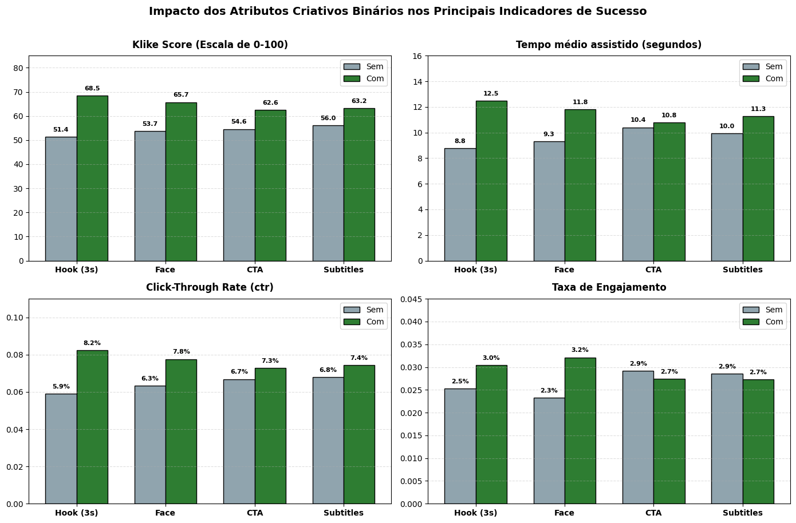
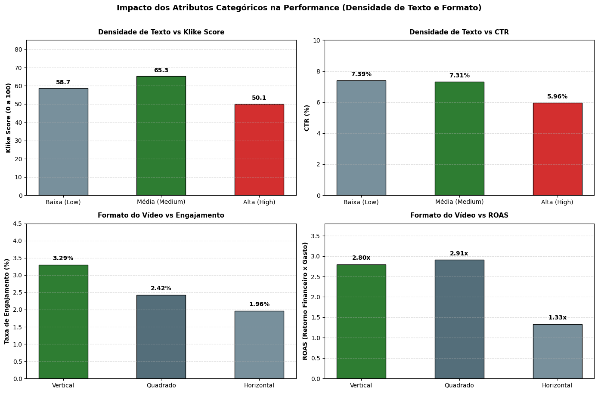
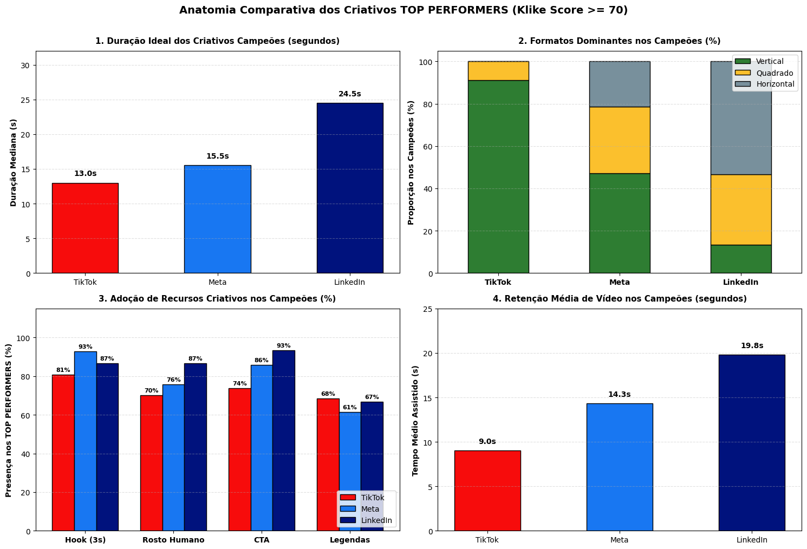

# 🎬 Klike Data Science Challenge

Solução do desafio de Data Science da **Millai / Klike**: análise exploratória de 500 criativos de vídeo (Meta, TikTok e LinkedIn), modelo preditivo para o `klike_score` e um *Recommendations Engine* que sugere melhorias quantificadas e contextualizadas por plataforma.

## 📁 Estrutura do Repositório

| Arquivo | Conteúdo |
|---|---|
| `eda.ipynb` | **Parte 1** – Análise exploratória (perfil dos dados, atributos × performance, padrões por plataforma) |
| `modelagem_e_recommendation_engine.ipynb` | **Parte 2** – Modelagem do `klike_score` e **Parte 3** – Recommendations Engine |
| `klike_challenge_dataset.csv` | Base de dados fornecida |
| `requirements.txt` | Dependências do projeto |
| `README.` | Decisões, conclusões e **Parte 4** – Visão de Produto |

---

## 🛠️ Como Executar o Projeto Localmente

### Pré-requisitos
- **Python 3.10+** ([download oficial](https://www.python.org/downloads/))
- **Git**

### Passo a passo (PowerShell)
```powershell
# 1. Clonar o repositório
git clone https://github.com/CarlosNeto242/klike-challenge.git
cd klike-challenge

# 2. Criar e ativar o ambiente virtual. Digite no PowerShell:
python -m venv .venv
.venv\Scripts\Activate

# 3. Instalar as dependências
pip install -r requirements.txt

> No Linux/macOS, ative o ambiente com `source .venv/bin/activate`.
```

## 1. Análise Exploratória (EDA)

### 1.1 Perfil Geral dos Dados

#### **1.11 Tipagem** 
Antes de qualquer análise, cada variável foi convertida para o tipo adequado:
- `platform`, `category`, `objective`, `format` → categóricas **nominais**;
- `text_density` (low < medium < high) e `target_audience_age` (18-24 < … < 45+) → categóricas **ordinais**, preservando a ordem natural;
- `has_subtitle` → booleano *nullable* (único booleano com nulos); `date` → datetime.

A conversão foi validada comparando as contagens de cada categoria antes e depois (nenhum valor foi perdido).

#### **1.12 Valores faltantes** 
7 colunas possuem nulos (entre 5% e 9,2% cada), e **38,2% das linhas** têm ao menos um nulo. Dessa forma, nâo é inviável descartar quase 40% das linhas pq elas possuem nulos. Além disso, para tratar esses casos nulo, eu faria o seguinte:

| Coluna | Tratamento |
|---|---|
| `cpc`, `revenue` | Podem ser **reconstruídas** pelas identidades `cpc = spend / clicks` e `revenue = roas × spend` (validadas nas linhas completas) |
| `has_subtitle`, `video_duration_s`, `music_voice_ratio`, `avg_watch_time_s`, `engagement_rate` | Imputação pela **mediana** (aplicada na etapa de modelagem) |

#### **1.13 Distribuições** 

Para analisar a distribuição das variáveis, separei em 2 etapas: uma para analisar as variáveis numéricas e outra para as categóricas/booleanas. Para analisar as variáveis quantitativas, gerei uma tabela `.describe()` para ter uma visão geral sobre as principais métricas dessas variáveis. Após isso, também plotei um boxplot de cada uma delas para entender melhor a distribuição:

- `impressions`, `clicks`, `cpc`, `spend`, `conversions`, `revenue` e `roas`: têm forte assimetria à direita. Como se tratam de métricas de sucesso, faz sentido do ponto de vista de negócio - a maioria dos criativos "dão errado"/fracassam, enquanto a minoria consegue suceder. 
- `video_duration_s` e `avg_watch_time_s`: possuem também uma assimetria a direita. Considerando que a maioria dos criativos vêm do TikTok/Meta, os vídeos dessas redes sociais tendem a ser mais curtos.
- `music_voice_ratio`, `ctr`, `engagement_rate` e `klike_score`: possuem uma distribuição mais simétrica

Para analisar as distribuições das variáveis categóricas/booleanas, segui uma linha de raciocínio análoga as variáveis quantitativas: uma tabela utilizando `value_counts()` e gráficos de frequência dos valores de cada variável: 

- `platform`, `category`, `objective` e `format`: o contexto geral dos criativos é definido: vídeos verticais em redes sociais a respeito de E-commerces.
- `text_density` (Medium), `is_retargeting` (False),`has_cta` (True) e `has_subtitle` (True): são atributos que possuem uma opção com maior presença nos criativos (conforme informado no título desse tópico)
- `target_audience_age`, `has_hook` e `has_face`: esse atributos possuem suas opções bem divididas.

#### **1.14 Outliers** 

A decisão foi separar dois casos:

- **Valores extremos reais** (cauda longa das métricas de volume): **mantidos**, pois representam campanhas de grande escala/bem sucedidas. Entretanto, como as características dos ativos se divergem bastante ao depender da plataforma/contexto, é válido analisarmos esses outliers por plataforma.
- **Erros de dado**, identificados por inconsistência entre colunas que deveriam bater entre si: campanhas com impressões infladas (o `ctr` não confere com `clicks / impressions`), CPC inflado ou `spend` inflado (o `cpc` não confere com `spend / clicks`). Esses casos seriam corrigidos pela coluna consistente ou removidos.


### 1.2 Atributos do Criativo × Performance

Para conseguir medir o impactos dos atributos na performance, primeiro analisei os atributos binários, comparando as suas métricas de sucesso quando o estado dela está em `True` e `False`. Fiz o mesmo para as variáveis `text_density` e `format`, só que ao invés de comparar o estado em `True` e `False`, eu comparei o estado entre os diferentes estados 

| Atributo | Efeito observado (com vs. sem) |
|---|---|
| **Hook nos 3s** | Score 51,4 → **68,5** (+17 pts) · CTR 5,9% → **8,2%** (+39%)|
| **Rosto humano** | Score 53,7 → **65,7** (+12 pts) · Engajamento 2,3% → **3,2%** (+38%)|
| **CTA** | Score 54,6 → **62,6** (+8 pts) · CTR +9% |
| **Legendas** | Score 56,0 → **63,2** (+7 pts) · Retenção +13% |
| **Densidade de texto** | `medium` é o ponto ótimo (score **65,3**)|
| **Formato** | Vertical lidera em engajamento (3,3% vs 2,0% do horizontal)|

**Conclusão:** hook e rosto humano são os atributos de maior impacto, afetando simultaneamente atenção (retenção), ação (CTR) e qualidade (score).

Para as atributos numéricas, foi utilizado a função `.corr()` do pandas, assim como um mapa de calor indicando o quanto aquele atributo afeta em uma métrica de sucesso do vídeo. Com isso, chegou-se a conclusão que elas não afetam de forma significativa as métricas.


### 1.3 Padrões por Plataforma

Para ver o que funciona para cada plataforma, analisei os criativos *top performers* (`klike_score ≥ 70`) de cada plataforma. Com isso, chegou-se a conclusão que, de fato, cada plataforma se comporta de uma forma diferente (mais detalhes sobre números, olhar o Notebook)

**Implicação para o engine:** recomendações não podem ser genéricas. Encurtar um vídeo para 15s é ótimo no TikTok, mas prejudicial no LinkedIn, onde formatos explicativos performam melhor.

### 1.4 Visualizações

O notebook traz diversos gráficos. Entretanto, acredito que 3 deles merecem destaque para serem mostrados para um time de marketing
1. **Impacto dos atributos binários (hook, rosto, CTA, legendas) em score, retenção, CTR e engajamento**: Nesse gráfico, podemos ter uma dimensão mais direta to impacto dos 4 principais atributos do vídeo. Isso dá uma direção de ação direta para melhorar o criativo em análise

2. **Densidade de texto e formato vs score, CTR, engajamento e ROAS:** Esse gráfico complementa o primeiro, mostrando como os outros atributos categóricos afetam o criativo, permitindo uma tomada de decisão mais assertiva

3. **Anatomia dos *top performers* por plataforma (duração, formato, recursos criativos e retenção):** Na minha opinião, o gráfico mais importante dos 4. Mostra a receita para se fazer um vídeo de cada plataforma.


---

## 2. Modelagem do `klike_score`

### 2.1 Feature Engineering

- **Features utilizadas:** apenas variáveis conhecidas **antes da veiculação**: atributos do criativo (`has_hook`, `has_face`, `has_cta`, `has_subtitle`, `text_density`, `format`, `video_duration_s`, `music_voice_ratio`) e contexto (`platform`, `category`, `objective`, `target_audience_age`, `is_retargeting`).
- **Features excluídas:** métricas de performance (CTR, ROAS, engajamento etc.). Elas só existem após o anúncio rodar; usá-las tornaria o modelo inútil para avaliar um criativo novo (e introduziria vazamento de informação).
- **Encoding:** *one-hot* (`drop_first=True`) para categóricas; nulos imputados pela mediana.
- **Nova feature:** `watch_ratio = avg_watch_time_s / video_duration_s` (limitada a 100%), a fração do vídeo efetivamente assistida, que normaliza a retenção pela duração. Por ser uma métrica pós-veiculação, não entra no modelo do score, mas é usada no engine para quantificar o impacto em retenção.
- **Diagnóstico com OLS:** uma regressão linear (statsmodels) foi usada para inspecionar significância estatística e sinal de cada variável antes da modelagem final (R² ajustado = 71%).

### 2.2 Modelos

Divisão **80% treino / 20% teste** (`random_state=42`). Foram comparados:
- **Ridge Regression:** modelo linear com regularização, interpretável e robusto a variáveis pouco informativas;
- **Random Forest:** modelo não linear, capaz de capturar interações.

### 2.3 Avaliação (conjunto de teste)

| Modelo | R² | MAE | RMSE |
|---|:---:|:---:|:---:|
| **Ridge Regression** | **66,6%** | **6,73 pts** | **8,69 pts** |
| Random Forest | 51,1% | 8,53 pts | 10,51 pts |

O **Ridge foi escolhido**. Em uma escala de 0 a 100, ele erra em média **~7 pontos** ao avaliar um criativo que nunca viu, e explica dois terços da variação do score usando apenas informações de produção e canal. O fato de o modelo linear superar a floresta sugere que o `klike_score` se comporta como um **sistema aditivo**: cada boa prática soma pontos de forma relativamente independente.

### 2.4 Feature Importance

Pelos coeficientes do modelo linear (efeito em pontos de score, mantendo o resto constante):

| Variável | Efeito no score |
|---|---|
| `has_hook` | **+17,1 pts** |
| `text_density` medium vs high | **+14,3 pts** |
| `has_face` | **+11,8 pts** |
| `has_cta` | **+8,1 pts** |
| `has_subtitle` | **+7,5 pts** |
| `is_retargeting` | +4,3 pts (campanhas de retargeting pontuam mais) |
| `platform` (TikTok/Meta vs LinkedIn) | +3,4 a +5,3 pts |

`category`, `objective`, `target_audience_age` e `video_duration_s` não foram estatisticamente significativos. No caso de `category` e `objective`, parte disso se explica porque a categoria praticamente determina o objetivo (colinearidade).

**Faz sentido para o negócio?** Sim. Em feeds de rolagem infinita, a atenção é o recurso mais escasso: um anúncio que não prende nos primeiros 3 segundos (hook) e não gera identificação humana (rosto) é ignorado. Texto em excesso compete com o vídeo, e legendas atendem quem assiste sem som.

---

## 3. Recommendations Engine

Implementado como função Python (`generate_creative_recommendations`) no notebook de modelagem. Recebe **uma linha do dataset** e retorna as **top 3 recomendações** ordenadas por impacto.

**Como funciona (simulação contrafactual, "e se?"):**
1. **Score atual:** o modelo Ridge estima o score do criativo como ele está.
2. **Simulação de alavancas:** para cada boa prática ausente (hook, rosto, CTA, legendas, densidade de texto → `medium`), o criativo é alterado virtualmente e o modelo recalcula o score. A diferença é o **ganho estimado em pontos**.
3. **Contexto por plataforma:** o impacto em métricas de negócio (retenção/`watch_ratio`, CTR, engajamento e ROAS) é calculado comparando criativos **da mesma plataforma** com e sem o atributo no histórico.
4. **Priorização:** recomendações ordenadas pelo ganho estimado de score.

**Exemplo de saída:**
```
[Prioridade 1] Adicionar Gancho (Hook) nos primeiros 3 segundos
  └ Impacto no Score: +X pts
  └ Impacto Estimado nas Métricas de Sucesso (TikTok):
      • Retenção (Watch Ratio): +16.4 p.p.
      • Taxa de Cliques (CTR):  +2.33 p.p.
      • ROAS Estimado:          +0.99x
```

**Limitações conhecidas:** as estimativas vêm de padrões observacionais (correlação, não causalidade), e o ganho de score do modelo linear é o mesmo em todas as plataformas. A contextualização vem dos benchmarks de KPI por plataforma. Grupos pequenos (ex.: LinkedIn, 83 campanhas) geram estimativas menos estáveis.

---

## 4. Visão de Produto e Próximos Passos (Product & Engineering Vision)

### 4.1. Novas Features Extraíveis de Vídeo Bruto

O dataset atual trabalha com metadados agregados e binários (`has_hook`, `has_face`, etc.). Em um produto escalável e maduro, uma esteira de inteligência artificial multimodal processaria diretamente o arquivo `.mp4` para extrair variáveis comportamentais e estruturais contínuas de altíssima granularidade:

1. **Visão Computacional e Dinâmica de Edição:**
   - **Ritmo de Cortes e Mudanças de Cena:** Frequência de transições por segundo. Em plataformas verticais como o TikTok, a transição constante entre cenários/fundos prendem mais a atenção do usuário.
   - **Contato Visual e Expressões Faciais:** Não apenas verificar a presença de um rosto, mas quais as emoções ele está transmitindo ao telespectador.
   - **Análise das HashTags presentes nos vídeos:** Identificação do tema por meio das hashtags utilizadas nos vídeos. Dessa forma, poderíamos identificar que tipo de conteúdo gera mais engajamento e assim otimizar a produção de conteúdo futuro.

2. **Processamento de Áudio e Fala (Audio & Speech AI):**
   - **Velocidade de Fala e Cadência (WPM - Words Per Minute):** Medição da cadência de fala via modelos ASR (*Whisper*), identificando pausas mortas ou trechos monótonos no início do vídeo.
   - **Classificação Semântica do Gancho (*Hook Categorization* via NLP):** Categorização do gancho inicial dos primeiros 3 segundos em arquétipos comprovados (ex: *Gancho de Dor/Problema*, *Curiosidade*, *Antes e Depois*, *Controvérsia*).
   - **Proporção Harmônica e *Trending Sounds*:** Detecção da presença de faixas comerciais genéricas versus músicas e áudios que estão em alta (*trending*) no algoritmo da plataforma no momento da veiculação.

---

### 4.2. Arquitetura de Produção e Estratégia de Deploy

Para entregar valor imediato às equipes de marketing, criação e tráfego pago, a solução foi pensada como uma aplicação web interativa, acessível e de baixa complexidade operacional:

1. Desenvolvimento de um site web utilizando o framework Django
2. Criando uma página dentro desse site contendo os campos de texto que o usuário poderá adicionar 
3. Por conta de Django funcionar com o python. Ao entrar na rota e executar um POST, criaríamos uma função para a rota da página, função que poderíamos simplesmente pegar o request.POST para obter cada campo que o usuário preencheu 
4. Com isso, pegaríamos cada campo e passaríamos ele como argumento na nossa função.
5. Renderizamos a mesma página, só que agora passamos para o HTML as respostas (`return render(request, "pagina.html", {'respostas': all_respostas})`)
6. Com o site criado, poderíamos finalmente dar deploy nele usando algum serviço para isso. Eu escolheria o Render para isso


### 4.3. O que faria com mais tempo e mais dados?

1. **Modelos Especializados por Plataforma:**
   - No projeto atual, treinamos um modelo "global" devido à limitação de dados (500 linhas no total, ou seja, "cerca" de 160 por plataforma). Com mais dados históricos e o devido tempo, a abordagem alternativa seria treinar **três modelos independentes (um para TikTok, um para Meta e outro para LinkedIn)**, capturando com precisão cirúrgica a receita de sucesso e a sensibilidade de cada rede.
2. **Uso de I.A generativa (LLM):**
   - Integrar uma API de algum modelo de linguagem (Claude Opus 5.5, Gemini Argon...) para tornar as análises ainda mais personalizadas. Com um bom "prompt" de instrução passado via código, as resposta poderiam ser mais completas e abrangir insights além daqueles que um modelo de regressão conseguiria nos dar de forma direta.
3. **Validação mais robusta e tratamento de dados no pipeline:**
   - Substituir a divisão única treino/teste por **validação cruzada** (e *tuning* de hiperparâmetros), e mover a imputação/correção de inconsistências para um pipeline (`sklearn.Pipeline`), garantindo que o mesmo tratamento seja aplicado no treino e em produção.
4. **Recomendações de duração e formato por plataforma + validação causal:**
   - Incluir no engine alavancas de duração ideal e formato por plataforma (identificadas na EDA) e validar o impacto real das recomendações com **testes A/B**, já que os efeitos atuais são estimados a partir de dados observacionais.
